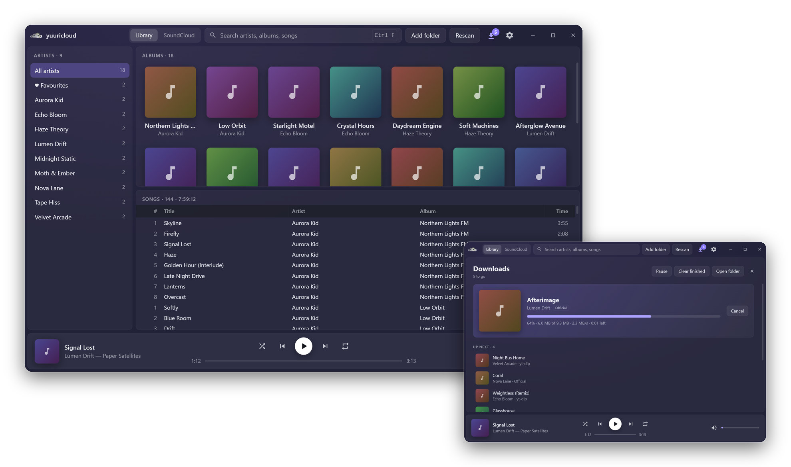
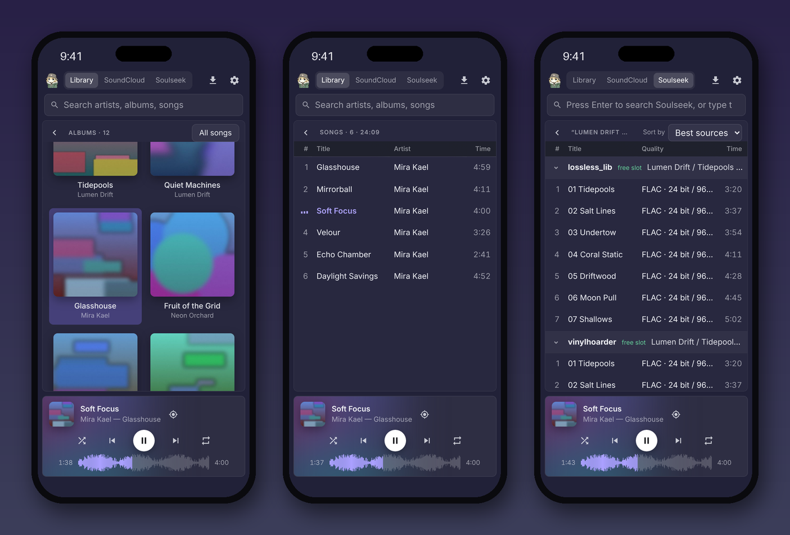
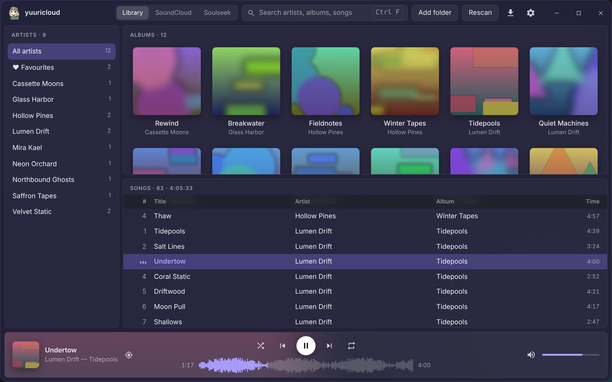
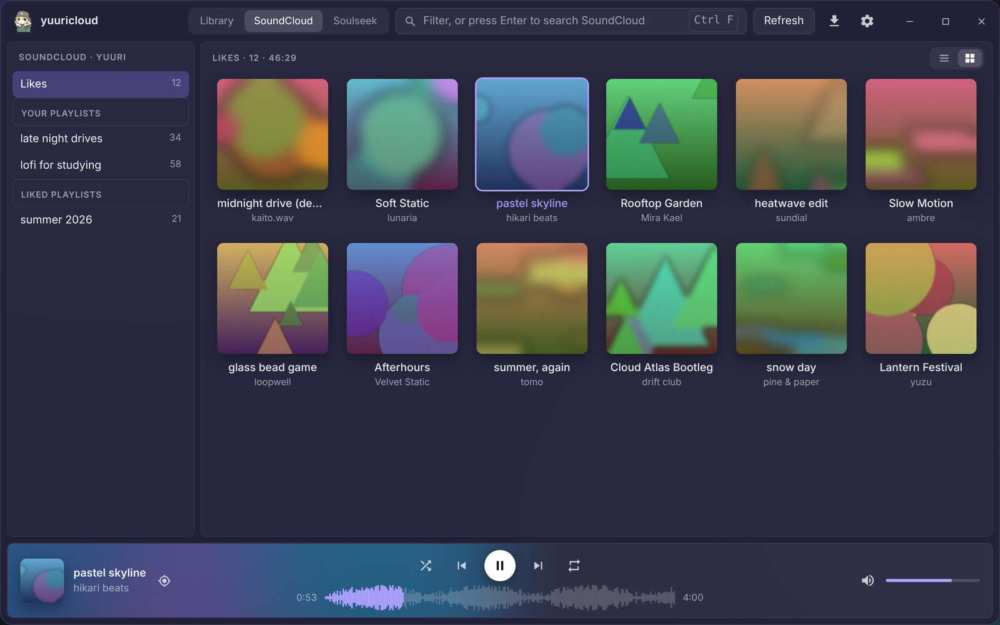
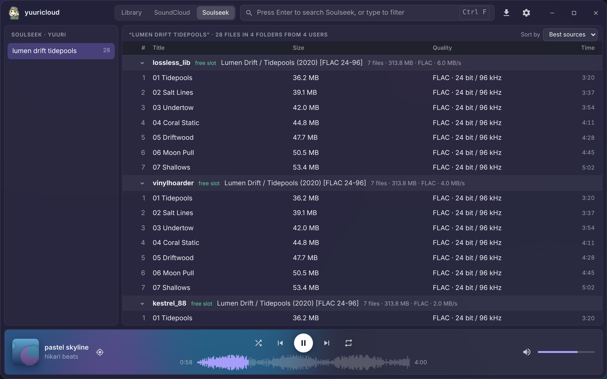
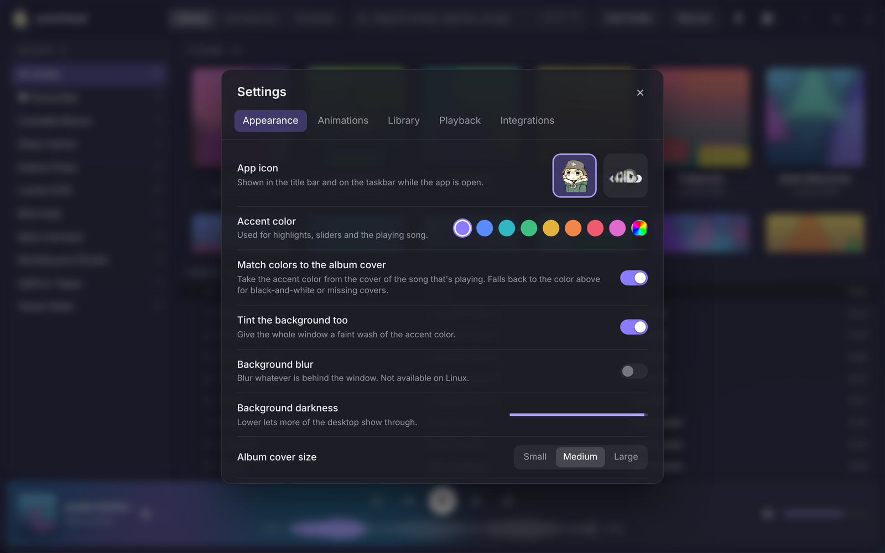

<h1> yuuricloud</h1>

[](https://github.com/lrd14/yuuricloud/actions/workflows/release.yml)
[](https://github.com/lrd14/yuuricloud/releases/latest)
[](https://github.com/lrd14/yuuricloud/releases)
[](https://github.com/lrd14/yuuricloud/releases/latest)
[](https://tauri.app)

A small, fast music player for your own music, your SoundCloud and Soulseek. For Windows, macOS, Linux, iPhone
and iPad.

<p align="center"></p>

## Contents

- [What it does](#what-it-does)
- [Install](#install)
  - [Windows](#windows) · [macOS](#macos) · [Linux](#linux) · [iPhone and iPad](#iphone-and-ipad) · [Updating](#updating)
- [Getting started](#getting-started)
- [Guides](#guides)
  - [Add your music](#add-your-music)
  - [Put music on your iPhone](#put-music-on-your-iphone)
  - [Connect SoundCloud](#connect-soundcloud)
  - [Download from SoundCloud](#download-from-soundcloud)
  - [Search and download on Soulseek](#search-and-download-on-soulseek)
  - [Scrobble to Last.fm](#scrobble-to-lastfm)
  - [Show what you're playing on Discord](#show-what-youre-playing-on-discord)
- [Using yuuricloud](#using-yuuricloud)
- [Troubleshooting](#troubleshooting)
- [Where your data is kept](#where-your-data-is-kept)
- [For developers](#for-developers)

## What it does

- **Your music library**: point it at your music folders and it sorts everything into artists and albums, with
  covers. Fast, even with tens of thousands of songs.
- **SoundCloud**: play your likes, your playlists and SoundCloud search in the same player, and download songs.
- **Soulseek**: search the Soulseek network and download music straight into your library.
- **Last.fm** scrobbling and a **Discord** "Listening to" status.
- **Looks how you like**: accent colors that follow the album cover, a SoundCloud-style waveform seek bar, compact
  lists, animations you can tone down or turn off.
- **iPhone and iPad** app with your music, SoundCloud and Soulseek, made for one hand on a phone and three panels
  on an iPad or an unfolded iPhone Duo.

<p align="center"></p>

## Install

Download the file for your system from the **[latest release](https://github.com/lrd14/yuuricloud/releases/latest)**.

### Windows

1. Download `yuuricloud_x.y.z_x64-setup.exe` and run it. (The `.msi` installs the same app; `x64-portable.exe` runs
   without installing anything.)
2. Windows may show **"Windows protected your PC"**, because the app isn't signed. Click **More info → Run anyway**.

### macOS

1. Download `aarch64.dmg` if your Mac has an Apple chip (M1 or newer), or `x64.dmg` for an Intel Mac. Not sure?
    → **About This Mac**.
2. Open the `.dmg` and drag yuuricloud into **Applications**.
3. The app isn't signed, so the first time, **right-click it → Open → Open**. If macOS says it's "damaged", open
   Terminal and run:
   ```bash
   xattr -cr /Applications/yuuricloud.app
   ```

### Linux

- **Any distro**: download the `.AppImage`, make it runnable and start it:
  ```bash
  chmod +x yuuricloud_*.AppImage && ./yuuricloud_*.AppImage
  ```
- **Debian / Ubuntu**: `sudo apt install ./yuuricloud_*_amd64.deb`
- **Fedora**: `sudo dnf install ./yuuricloud-*.x86_64.rpm`

Playing music needs the GStreamer plugins (`gstreamer1.0-plugins-good`, `-bad` and `-ugly` on Debian/Ubuntu), which
most desktops already have.

### iPhone and iPad

yuuricloud isn't on the App Store, so you install the `iOS-unsigned.ipa` from the release yourself. The easiest way
is [AltStore](https://altstore.io), which signs it with your own Apple ID:

1. On your computer, install **AltServer** from [altstore.io](https://altstore.io). On Windows, also install iTunes
   and iCloud from Apple's website (not the Microsoft Store versions).
2. Connect the iPhone with a cable, tap **Trust** on the phone, and use AltServer to install **AltStore** on it,
   signing in with your Apple ID.
3. On the iPhone, turn on **Settings → Privacy & Security → Developer Mode** and restart when asked.
4. Get the `.ipa` onto the phone (AirDrop, iCloud Drive, or email it to yourself), then in AltStore tap
   **My Apps → +** and pick it.

With a free Apple ID, apps installed this way stop opening after **7 days**. Open AltStore and refresh while the
phone and computer are on the same Wi-Fi to reset the clock. [SideStore](https://sidestore.io) works the same way
and can refresh without the computer.

### Updating

When a new version is out, an **Update** button shows in the title bar (turn the check off in Settings →
Playback). It opens the release page, where you download and install the new version over the old one. Your
library and settings are kept.

## Getting started

The first time yuuricloud opens, a short **setup guide** walks you through adding your music, picking a color and
connecting SoundCloud, Soulseek, Last.fm and Discord. Every step can be skipped and set up later in **Settings**
(the gear in the title bar, or **Ctrl+,**). To see the guide again: Settings → Playback → **Run setup**.

## Guides

### Add your music

1. Click **Add folder** in the title bar (or Settings → Library → **Add folder…**) and pick the folder your music
   is in. Add as many as you like.
2. yuuricloud scans it and shows your **artists**, their **albums** and the **songs**. Click an artist, then an
   album; **double-click** a song, album or artist to play it.

<p align="center"></p>

**How artists and albums are found.** The folder layout comes first; file tags fill in the rest (title, track
number, year, length):

```
<folder>/<Artist>/<Album (1997)>/[CD1/]01 - Title.mp3
<folder>/<Artist - Album>/01 Title.flac
```

If your tags are tidier than your folders, turn on Settings → Library → **Name artists and albums from file tags**.

**Covers** come from a `cover.jpg`, `folder.jpg` or `front.jpg` in the album folder, or from the picture inside the
songs. To fix a song's title, artist, album or cover, right-click it → **Edit song info…**; the new cover can go on
the whole album at once.

**New songs** show up on the next scan: yuuricloud rescans when it opens (Settings → Library → **Rescan on
startup**), or click **Rescan** (F5). Rescans only re-read files that changed.

Plays mp3, flac, m4a/aac, ogg, opus and wav.

### Put music on your iPhone

The iPhone app plays the music in its own folder. To fill it:

- **From the Files app**: copy or move songs into **On My iPhone → yuuricloud** (from iCloud Drive, a USB stick,
  AirDrop, anywhere Files can reach).
- **From a computer**: connect the iPhone and drag songs onto **yuuricloud** in the iPhone's **Files** tab in
  Finder (Mac), or in the **Apple Devices** app (Windows).
- **From Soulseek**: songs you download in the app land in that folder too.

New songs show up when you switch back to yuuricloud.

### Connect SoundCloud

**On a computer:** Settings → Integrations → SoundCloud → **Connect**. Your browser opens SoundCloud; approve
access, and the app picks it up by itself. Then switch the title bar to **SoundCloud** to see your likes, your own
and liked playlists. Type in the search box to filter what's on screen, or press **Enter** to search all of
SoundCloud.

<p align="center"></p>

**On an iPhone:** Settings → Integrations → SoundCloud → **Connect**. Safari opens SoundCloud; sign in and
approve, then tap **Open yuuricloud** and allow it. The app finishes signing in by itself.

Already signed in on your computer? You can link the phone from there instead:

1. On the computer, open Settings → Integrations → SoundCloud and click **Link phone…**, then approve in the
   browser. A QR code appears.
2. Point the iPhone's camera at it and tap **Open in yuuricloud**. (Or click **Copy code** and paste it on the
   phone under Settings → Integrations → SoundCloud → **Link**.)

The phone gets a login of its own and the computer stays signed in. Anyone with the code can use your SoundCloud
account, so don't share it.

Good to know:

- Each song downloads to a small cache before it plays, so there's a short wait at the start; the next song in
  the queue loads ahead of time.
- Songs SoundCloud only allows a preview of (Go+ or region-locked) play 30 seconds. Songs that can only be played
  on SoundCloud itself are greyed out.

<details>
<summary>Use your own SoundCloud app instead of yuuricloud's (optional)</summary>

Registering a SoundCloud app needs an **Artist Pro** subscription.

1. At https://soundcloud.com/you/apps, set the app's redirect URI to `http://127.0.0.1:8974/callback`. (Your own
   app works on the computer only.)
2. In Settings → Integrations → SoundCloud → **Use your own SoundCloud app**, paste its Client ID and Client
   Secret and click **Save keys**.
3. Click **Connect**.

Clear both keys and save to go back to yuuricloud's app.
</details>

### Download from SoundCloud

Right-click a song → **Download**. To save a whole list, right-click **Likes**, a playlist or search results in the
left panel → **Download all**. Progress shows on the **Downloads** page (the arrow in the title bar).

Songs are saved as "Artist - Title" with title, artist and cover tags, into `Music/SoundCloud` (change it in
Settings → Integrations → SoundCloud), and show up in your library on their own.

- **Songs the artist allows downloads for** are saved straight from SoundCloud, often as the original upload
  (WAV, FLAC and so on).
- **Any other song** needs [yt-dlp](https://github.com/yt-dlp/yt-dlp). Turn on **Use yt-dlp for other songs** and
  click **Download for me**, or install it yourself and paste its path. This is off by default, because saving
  songs the artist hasn't made downloadable is against SoundCloud's terms.

Downloading is on the computer only.

### Search and download on Soulseek

[Soulseek](https://www.slsknet.org) is a file-sharing network with a lot of music, often in lossless quality.

**On a computer:**

1. Settings → Integrations → Soulseek: click **Download for me** to get [slskd](https://github.com/slskd/slskd),
   the free Soulseek program yuuricloud runs in the background.
2. Enter a Soulseek **username and password**. A name nobody has taken yet becomes a new free account the first
   time you connect.
3. Click **Connect**. Turn on **Connect when yuuricloud opens** to skip this next time.

**On an iPhone:** the app is its own Soulseek client, so there's nothing to install. Enter your username and
password in Settings → Integrations → Soulseek and tap **Connect**.

**Searching:** switch the title bar to **Soulseek**, type what you want and press **Enter**. Results are grouped
by user and folder, with each file's quality; users with a free slot and a fast connection come first.
**Double-click** a song (tap it on a phone) to download it, or right-click (hold) for **Download whole folder**.

<p align="center"></p>

Downloads show on the **Downloads** page and land in `Music/Soulseek` (on the iPhone, a `Soulseek` folder inside
yuuricloud's folder), and show up in your library as they finish. A download can wait in the other user's queue
for a while before it starts; the Downloads page shows your place in line.

- **Sharing:** your Soulseek downloads are always shared, and **Share my music library** shares the rest of your
  library too. Many Soulseek users won't send files to people who share nothing. The Downloads page shows who is
  downloading from you.
- **iPhone:** iOS pauses apps in the background, so downloads (and sharing) only keep going while yuuricloud is
  open or playing music.
- Soulseek itself is legal, but much of what's shared on it is copyrighted. What you download or share is your
  responsibility.

<details>
<summary>More Soulseek options (computer)</summary>

- **Listening port:** picked automatically. If downloads stay queued for a long time, others may not be able to
  reach you: forward a port (TCP) on your router to this computer and enter it under **Listening port**.
- **Your own slskd:** turn off **Run slskd for me** and enter its address and an API key.
- **Built-in Soulseek client (test):** connects without slskd, the way the iPhone app does.
- "Download for me" (slskd and yt-dlp) fetches the latest official release from GitHub and checks it against the
  checksum GitHub publishes before using it.
</details>

### Scrobble to Last.fm

Settings → Integrations → Last.fm → **Connect**, approve access in the browser, then click **I've approved it**.
Works the same on the iPhone (approve in Safari, then switch back).

A song counts after half of it, or 4 minutes, has played; songs under 30 seconds don't count. Turn scrobbling off
and on with **Scrobble songs**.

<details>
<summary>Use your own Last.fm API account (optional)</summary>

Create one at https://www.last.fm/api/account/create (any name works). Under **Use your own Last.fm API account**,
paste its key and shared secret and click **Save keys**, then connect again.
</details>

### Show what you're playing on Discord

1. Create an application at https://discord.com/developers/applications. Its name is what your status shows
   ("Listening to *yuuricloud*").
2. Settings → Integrations → Discord: paste its **Application ID** and turn on **Show listening status**. Discord
   needs to be running.

The status shows the album cover from Last.fm when Last.fm knows the album. Computer only.

## Using yuuricloud

**Computer shortcuts**

| Key | Does |
| --- | --- |
| Space | Play / pause |
| Ctrl + ← / → | Previous / next song |
| ↑ / ↓, then Enter | Pick a song and play it |
| Ctrl + F | Search |
| Ctrl + L | Show the playing song |
| F5 | Rescan the library |
| Ctrl + , | Settings |

**The player:** the shuffle button switches between **off**, **shuffle** (every song once, in a random order) and
**random** (the dice: each next song is picked afresh, so songs can come up again). The ♥ next to the playing song
adds it to your favourites, or likes it on SoundCloud. The queue button (bottom right, next to the song on a
phone) shows what's playing, what played before and what's up next: click a song to jump to it, or ✕ to take it
out.

Right-click a song for **Play next**, **favourites** (♥ Favourites appears at the top of the artist list), **Edit
song info…** and more. Click the song name in the player to jump to it in the library.

**On a phone** the library shows one panel at a time: tap an artist, then an album, then a song to play it; the
back arrow goes up a level. Hold a song for its menu.

**Settings** has a lot to make it yours: accent color (or colors from the album cover), background blur and
darkness, cover and interface size, a compact song list, animations, the waveform seek bar, single-click play,
fades, and **Resume where you left off**, which reopens the same song, queue and view you had when you closed the
app.

<p align="center"></p>

## Troubleshooting

- **Windows says "Windows protected your PC".** Click **More info → Run anyway**. The app isn't signed with a paid
  certificate.
- **macOS says the app is "damaged" or can't be opened.** Run `xattr -cr /Applications/yuuricloud.app` in
  Terminal, then open it again.
- **A song won't play ("format not supported").** The file is usually empty or cut off, often a download that
  didn't finish. On Linux, install the GStreamer plugins listed under [Linux](#linux).
- **The iPhone app stopped opening.** With a free Apple ID it expires after 7 days; refresh it in AltStore or
  SideStore.
- **Soulseek downloads stay queued.** The other user may be busy; the Downloads page shows your place in line. On
  a computer, forwarding the listening port helps others reach you.
- **SoundCloud sign-in page stays blank** (own SoundCloud app only). The redirect URI in yuuricloud must be exactly
  the one saved in your SoundCloud app.

## Where your data is kept

Your library cache, settings and logins (SoundCloud, Last.fm, Soulseek, API keys) are saved in `settings.json` and
`library.json` in the app data folder:

- **Windows:** `%APPDATA%\cloud.yuuri.player`
- **macOS:** `~/Library/Application Support/cloud.yuuri.player`
- **Linux:** `~/.local/share/cloud.yuuri.player`

Nothing is sent anywhere except to the services you connect. Sign-ins and scrobbles that use yuuricloud's shared
SoundCloud app and Last.fm account pass through a small Cloudflare Worker that adds the app's secret
([soundcloud-proxy](soundcloud-proxy/README.md)); everything else goes straight to SoundCloud and Last.fm.

## For developers

Built with [Tauri 2](https://tauri.app): a Rust backend and a plain HTML/CSS/JS frontend, no framework.

**Requirements:** [Rust](https://rustup.rs) (stable), [Node.js](https://nodejs.org) (only for the Tauri CLI), and
the [Tauri prerequisites](https://tauri.app/start/prerequisites/) for your system (WebView2 is built into Windows
10/11; Linux needs `webkit2gtk-4.1` and the GStreamer plugins).

```bash
npm install
npm run dev      # run it
npm run build    # release build and installers in src-tauri/target/release/bundle/
cd src-tauri && cargo test
```

**Releases:** pushing a version tag (`v0.5.0`), or running the **Release** workflow by hand, builds every system
on GitHub Actions and publishes a release once the computer builds pass. The **iOS** workflow builds the unsigned
`.ipa` on GitHub's Macs; the release runs it too, and it can be run by hand from the Actions tab.

**Shared SoundCloud app and Last.fm account:** their secrets live in a Cloudflare Worker, not in the app. See
[soundcloud-proxy/README.md](soundcloud-proxy/README.md) to deploy it; `BUILTIN_TOKEN_PROXY` in
`src-tauri/src/soundcloud.rs` and `BUILTIN_LASTFM_KEY` in `src-tauri/src/integrations.rs` point the app at it.

**Layout**

- `src/`: the UI (`index.html`, `style.css`, `main.js`)
- `src-tauri/src/lib.rs`: the commands the UI calls, and app startup (`main.rs` just starts it)
- `src-tauri/src/library.rs`: folder scanning, tag reading, artist/album rules (`cargo test` covers them)
- `src-tauri/src/soundcloud.rs`: SoundCloud sign-in, API calls, streaming and phone link codes
- `src-tauri/src/downloads.rs`: SoundCloud downloads (direct and yt-dlp)
- `src-tauri/src/slsk.rs`: Soulseek through slskd
- `src-tauri/src/slsk_native.rs`: the built-in Soulseek client (iPhone, and the computer's test switch)
- `src-tauri/src/integrations.rs`: Last.fm and Discord
- `src-tauri/src/editor.rs`: the song editor
- `src-tauri/src/tools.rs`: "Download for me" for yt-dlp and slskd
- `soundcloud-proxy/`: the Cloudflare Worker for the shared SoundCloud app and Last.fm account
